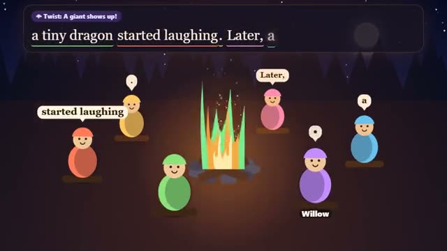

# Campfire Tales

One story, one word each. The fire adds twists. A multiplayer starter game from [Multiplayer Agent](https://multiplayeragent.com): 2D, party, 2–10 players, with bot storytellers that fill empty seats.

## How it plays

Sit round the fire and build a story together, a word or two each, in turn, before your timer runs out. Now and then the fire throws in a twist. At the end the story is read aloud and everyone votes for the best word.

Stuck? Tap one of the three suggestions under the box. If your time runs out, the fire whispers a word for you and the story moves on. Finished stories go in the story log (📜): the fire keeps its last few, and you can save any story to your device or share it as text.

**Controls:** Type a word and press Enter, or tap one of the suggestions; tap a word to vote.

## Make it yours in the Game Builder

Open the [Game Builder](https://multiplayeragent.com), choose **Start from a starter game** and pick Campfire Tales. It opens as version 1 in your studio, ready to play and publish. Then ask for changes, for example:

- Make it a spooky ghost-story night with scarier twists
- Let everyone pick the story's opening line by vote
- Draw a picture for each sentence of the story

## Run it yourself

1. Get a free publishable key (`pk_…`) at [multiplayeragent.com](https://multiplayeragent.com).
2. In `index.html`, put it in place of `pk_REPLACE_ME` in the `MP_CONNECT` block.
3. Open `index.html` in a browser. No build step and no server needed.

Without a key it still runs, offline against bots.

## How it is built

- One `index.html`. The comment at the top of the script maps the code and explains the multiplayer.
- **Host-run rounds:** One player's browser keeps the turn order, the twists and the timer, and counts the votes; if it leaves, the next player takes over.
- **Bots:** Bot storytellers fill the circle and add words of their own until friends join.
- **Live sync:** Every word appears round the fire for everyone the moment it's added.
- **Story log:** The fire keeps its last few stories; save any to your device or share it as text.
- **Leaderboard:** The most votes a player's words got in one story.
- The bots' words (and your suggestions) come from a small grammar in the WORDS section: add words or twists there.
- The story is read aloud with your browser's built-in voice (🔊 turns it off).
- `?attract` runs it offline with bots only. The preview video is recorded from it.

## License

MIT.
